<!-- 此页由 .profile 与 GitHub Actions 生成 -->

<picture><source media="(prefers-color-scheme: dark)" srcset="./assets/identity-arcade-dark.svg"></picture>

**Web 应用 · Windows 工具 · Android · 计算机视觉**

[项目](#精选项目)　/　[语言](#语言分布)　/　[博客](#博客文章)　/　[链接](#链接与交流)

## GitHub 概览

<picture><source media="(max-width: 760px) and (prefers-reduced-motion: reduce) and (prefers-color-scheme: dark)" srcset="./assets/profile-stats-mobile-dark-still.svg"><source media="(max-width: 760px) and (prefers-reduced-motion: reduce)" srcset="./assets/profile-stats-mobile-light-still.svg"><source media="(prefers-reduced-motion: reduce) and (prefers-color-scheme: dark)" srcset="./assets/profile-stats-dark-still.svg"><source media="(prefers-reduced-motion: reduce)" srcset="./assets/profile-stats-light-still.svg"><source media="(max-width: 760px) and (prefers-color-scheme: dark)" srcset="./assets/profile-stats-mobile-dark.svg"><source media="(max-width: 760px)" srcset="./assets/profile-stats-mobile-light.svg"><source media="(prefers-color-scheme: dark)" srcset="./assets/profile-stats-dark.svg"></picture>

## 贡献与活动

<picture><source media="(prefers-color-scheme: dark)" srcset="./assets/pacman-dark.svg"></picture>

<picture><source media="(max-width: 760px) and (prefers-reduced-motion: reduce) and (prefers-color-scheme: dark)" srcset="./assets/weekly-activity-mobile-dark-still.svg"><source media="(max-width: 760px) and (prefers-reduced-motion: reduce)" srcset="./assets/weekly-activity-mobile-light-still.svg"><source media="(prefers-reduced-motion: reduce) and (prefers-color-scheme: dark)" srcset="./assets/weekly-activity-dark-still.svg"><source media="(prefers-reduced-motion: reduce)" srcset="./assets/weekly-activity-light-still.svg"><source media="(max-width: 760px) and (prefers-color-scheme: dark)" srcset="./assets/weekly-activity-mobile-dark.svg"><source media="(max-width: 760px)" srcset="./assets/weekly-activity-mobile-light.svg"><source media="(prefers-color-scheme: dark)" srcset="./assets/weekly-activity-dark.svg"></picture>

截至 2026-11-25 · <a href="https://github.com/users/BigdataZjk/contributions">GitHub 公开贡献日历</a> · <a href="./assets/identity-arcade-dark-still.svg">静态横幅</a> · <a href="./assets/pacman-dark-still.svg">静态贡献图</a>

## 精选项目

<table><tr><td valign="top" width="50%"><a href="https://github.com/BigdataZjk/Gantt"><picture><source media="(prefers-reduced-motion: reduce) and (prefers-color-scheme: dark)" srcset="./assets/project-gantt-dark-still.svg"><source media="(prefers-reduced-motion: reduce)" srcset="./assets/project-gantt-light-still.svg"><source media="(prefers-color-scheme: dark)" srcset="./assets/project-gantt-dark.svg"></picture></a> <strong><a href="https://github.com/BigdataZjk/Gantt">RSM / Gantt</a></strong> 用需求池、甘特图和工作日历协作排期。 更新于 2026-11-24</td><td valign="top" width="50%"><a href="https://github.com/BigdataZjk/GameReady"><picture><source media="(prefers-reduced-motion: reduce) and (prefers-color-scheme: dark)" srcset="./assets/project-gameready-dark-still.svg"><source media="(prefers-reduced-motion: reduce)" srcset="./assets/project-gameready-light-still.svg"><source media="(prefers-color-scheme: dark)" srcset="./assets/project-gameready-dark.svg"></picture></a> <strong><a href="https://github.com/BigdataZjk/GameReady">GameReady</a></strong> 便携的 Windows 游戏配置工具，支持 NAS 备份。 更新于 2026-11-04 &nbsp;·&nbsp; <a href="https://github.com/BigdataZjk/GameReady/releases/latest">发布 v0.1.26</a></td></tr><tr><td valign="top" width="50%"><a href="https://github.com/BigdataZjk/MilkTrackerAPP"><picture><source media="(prefers-reduced-motion: reduce) and (prefers-color-scheme: dark)" srcset="./assets/project-milktracker-dark-still.svg"><source media="(prefers-reduced-motion: reduce)" srcset="./assets/project-milktracker-light-still.svg"><source media="(prefers-color-scheme: dark)" srcset="./assets/project-milktracker-dark.svg"></picture></a> <strong><a href="https://github.com/BigdataZjk/MilkTrackerAPP">MilkTrackerAPP</a></strong> 记录宝宝的喂养时间与奶量。 更新于 2026-06-12</td><td valign="top" width="50%"><a href="https://github.com/BigdataZjk/YOLOv8-PySide6-GUI"><picture><source media="(prefers-reduced-motion: reduce) and (prefers-color-scheme: dark)" srcset="./assets/project-vision-dark-still.svg"><source media="(prefers-reduced-motion: reduce)" srcset="./assets/project-vision-light-still.svg"><source media="(prefers-color-scheme: dark)" srcset="./assets/project-vision-dark.svg"></picture></a> <strong><a href="https://github.com/BigdataZjk/YOLOv8-PySide6-GUI">YOLO GUI</a></strong> 为 YOLO 系列视觉模型提供图形界面。 更新于 2023-09-18 &nbsp;·&nbsp; 1 Star</td></tr></table>

[查看全部公开仓库](https://github.com/BigdataZjk?tab=repositories)

## 语言分布

<picture><source media="(max-width: 760px) and (prefers-reduced-motion: reduce) and (prefers-color-scheme: dark)" srcset="./assets/language-overview-mobile-dark-still.svg"><source media="(max-width: 760px) and (prefers-reduced-motion: reduce)" srcset="./assets/language-overview-mobile-light-still.svg"><source media="(prefers-reduced-motion: reduce) and (prefers-color-scheme: dark)" srcset="./assets/language-overview-dark-still.svg"><source media="(prefers-reduced-motion: reduce)" srcset="./assets/language-overview-light-still.svg"><source media="(max-width: 760px) and (prefers-color-scheme: dark)" srcset="./assets/language-overview-mobile-dark.svg"><source media="(max-width: 760px)" srcset="./assets/language-overview-mobile-light.svg"><source media="(prefers-color-scheme: dark)" srcset="./assets/language-overview-dark.svg"></picture>

<picture><source media="(max-width: 760px) and (prefers-reduced-motion: reduce) and (prefers-color-scheme: dark)" srcset="./assets/project-languages-mobile-dark-still.svg"><source media="(max-width: 760px) and (prefers-reduced-motion: reduce)" srcset="./assets/project-languages-mobile-light-still.svg"><source media="(prefers-reduced-motion: reduce) and (prefers-color-scheme: dark)" srcset="./assets/project-languages-dark-still.svg"><source media="(prefers-reduced-motion: reduce)" srcset="./assets/project-languages-light-still.svg"><source media="(max-width: 760px) and (prefers-color-scheme: dark)" srcset="./assets/project-languages-mobile-dark.svg"><source media="(max-width: 760px)" srcset="./assets/project-languages-mobile-light.svg"><source media="(prefers-color-scheme: dark)" srcset="./assets/project-languages-dark.svg"></picture>

查看语言数据与统计口径

**主语言**　非归档、非分叉的公开仓库，以 GitHub 标记的主语言计数。Python 6 个（50.0%），JavaScript 2 个（16.7%），Kotlin 1 个（8.3%），Rust 1 个（8.3%），TypeScript 1 个（8.3%），Vue 1 个（8.3%）。

**项目构成**　精选项目默认分支中 Git 记录的源文件字节，过滤依赖目录、构建产物和已识别的生成文件。

- **RSM / Gantt** TypeScript 53.2% / Go 23.4% / Shell 12.2% / CSS 8.0% / Other 3.2%
- **GameReady** Rust 62.7% / HTML 22.5% / JavaScript 13.8% / PowerShell 1.0%
- **MilkTrackerAPP** Kotlin 100.0%
- **YOLO GUI** Python 100.0%

## 技术栈

<picture><source media="(max-width: 760px) and (prefers-reduced-motion: reduce) and (prefers-color-scheme: dark)" srcset="./assets/tech-stack-mobile-dark-still.svg"><source media="(max-width: 760px) and (prefers-reduced-motion: reduce)" srcset="./assets/tech-stack-mobile-light-still.svg"><source media="(prefers-reduced-motion: reduce) and (prefers-color-scheme: dark)" srcset="./assets/tech-stack-dark-still.svg"><source media="(prefers-reduced-motion: reduce)" srcset="./assets/tech-stack-light-still.svg"><source media="(max-width: 760px) and (prefers-color-scheme: dark)" srcset="./assets/tech-stack-mobile-dark.svg"><source media="(max-width: 760px)" srcset="./assets/tech-stack-mobile-light.svg"><source media="(prefers-color-scheme: dark)" srcset="./assets/tech-stack-dark.svg"></picture>

## 博客文章

<ul><li><a href="https://blog.zhangjinke.com:11443/121.html">Spark SQL高阶函数（数组&amp;Map）</a></li><li><a href="https://blog.zhangjinke.com:11443/115.html">宝宝记奶APP</a></li><li><a href="https://blog.zhangjinke.com:11443/112.html">Docker部署Windows</a></li></ul>

## 链接与交流

<table><tr><td><strong><a href="https://github.com/BigdataZjk?tab=repositories">GitHub · 全部仓库</a></strong></td><td>源码与项目发布</td></tr><tr><td><strong><a href="https://blog.zhangjinke.com:11443/">科记 · 个人博客</a></strong></td><td>技术实践与项目记录</td></tr><tr><td><strong><a href="https://blog.csdn.net/qq_43376286">CSDN · 春马与夏</a></strong></td><td>技术文章与旧笔记</td></tr><tr><td><strong>QQ</strong></td><td><code>22432832</code></td></tr></table>

动效组件 <a href="https://github.com/abozanona/pacman-contribution-graph">Pac-Man Contribution Graph</a>
